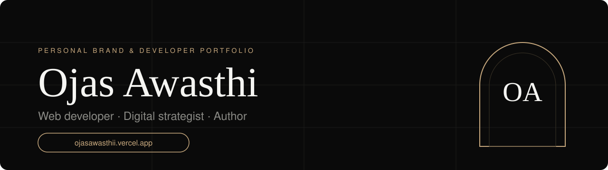
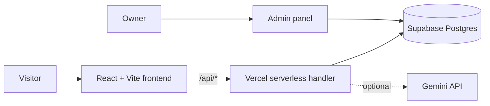

<div align="center">



<br/>

<a href="https://ojasawasthii.vercel.app"></a>
<a href="https://www.linkedin.com/in/ojassawasthi"></a>
<a href="mailto:ojassawasthi@gmail.com"></a>

<br/><br/>


<br/>

<sub><a href="#01--overview">Overview</a> · <a href="#02--features">Features</a> · <a href="#03--architecture">Architecture</a> · <a href="#04--tech-stack">Stack</a> · <a href="#05--getting-started">Getting started</a> · <a href="#06--environment-variables">Environment</a> · <a href="#07--deployment">Deployment</a> · <a href="#08--security">Security</a></sub>

</div>


## 01 · Overview

The source code of **[ojasawasthii.vercel.app](https://ojasawasthii.vercel.app)**, the personal website of **Ojas Awasthi**, a web developer, digital marketer and author from Lucknow, India.

It's a fast, minimal portfolio with a private admin panel, a Supabase backend and a search-engine-friendly build.

<!-- Add a screenshot later: save it as docs/preview.png, then replace this line with:
<p align="center"></p>
-->


## 02 · Features

<table>
  <tr>
    <td width="50%" valign="top"><b>Premium, minimal design</b><br/><sub>Light and dark mode with smooth motion</sub></td>
    <td width="50%" valign="top"><b>Animated loading screen</b><br/><sub>Shown once per session</sub></td>
  </tr>
  <tr>
    <td valign="top"><b>Project showcase</b><br/><sub>Case-study pages, loaded from Supabase</sub></td>
    <td valign="top"><b>Private admin panel</b><br/><sub>Magic-link login to add and edit projects, read messages and manage content</sub></td>
  </tr>
  <tr>
    <td valign="top"><b>Contact form</b><br/><sub>Saved to Supabase with spam protection and rate limiting</sub></td>
    <td valign="top"><b>SEO-ready</b><br/><sub>Pre-rendered pages, dynamic <code>sitemap.xml</code>, <code>robots.txt</code>, <code>llms.txt</code>, structured data (JSON-LD) and Open Graph tags</sub></td>
  </tr>
  <tr>
    <td valign="top"><b>Optional AI assistant</b><br/><sub>"Ask about Ojas", powered by the Gemini API and answering only from a fixed knowledge file</sub></td>
    <td valign="top"><b>Optional newsletter link</b><br/><sub>Opens the beehiiv signup page</sub></td>
  </tr>
</table>


## 03 · Architecture




## 04 · Tech stack

| Layer | Tools |
|---|---|
| Frontend | React, Vite, TypeScript, Tailwind CSS |
| Backend | One merged Vercel serverless handler (`/api/index`) |
| Database and auth | Supabase (Postgres, Row Level Security, magic-link auth, storage) |
| Hosting | Vercel |
| AI (optional) | Google Gemini API |

> Edit this table to match `package.json` if your stack differs.

**Project structure (simplified)**

```
.
├── api/                # serverless handler and server-only helpers
├── public/             # static files (robots.txt, favicon, images)
├── scripts/            # build scripts (pre-rendering)
├── src/
│   ├── components/     # UI components
│   └── content/        # site content (site.ts)
├── vercel.json         # rewrites and headers
└── package.json
```


## 05 · Getting started

```bash
git clone <this-repo-url>
cd <repo-folder>
npm install
cp .env.example .env.local   # then fill in your own values
npm run dev
```

| Command | What it does |
|---|---|
| `npm run dev` | Start the local dev server |
| `npm run build` | Production build and pre-render |
| `npm run lint` | Type-check the frontend and the API |


## 06 · Environment variables

Set these in your hosting provider's settings. **Never commit real values.**

<details>
<summary><b>Show all variables</b></summary>

<br/>

| Name | Required | Where it's used |
|---|---|---|
| `VITE_SUPABASE_URL` | Yes | Frontend and build |
| `VITE_SUPABASE_ANON_KEY` | Yes | Frontend (public key) |
| `NEXT_PUBLIC_SUPABASE_URL` | Yes | Same Supabase project URL |
| `NEXT_PUBLIC_SUPABASE_ANON_KEY` | Yes | Same public key |
| `SUPABASE_SERVICE_ROLE_KEY` | Yes | **Server only** (serverless handler) |
| `ADMIN_EMAIL`, `VITE_ADMIN_EMAIL` | Yes | Who can open the admin panel |
| `VITE_SITE_URL`, `NEXT_PUBLIC_SITE_URL` | Yes | Canonical URL for SEO |
| `VITE_GOOGLE_SITE_VERIFICATION` | No | Search Console verification tag |
| `VITE_GA_MEASUREMENT_ID` | No | Analytics |
| `GEMINI_API_KEY`, `GEMINI_MODEL` | No | AI assistant (hidden when unset) |
| `VITE_NEWSLETTER_URL` | No | beehiiv signup link |
| `RESEND_API_KEY` | No | Email alerts (not required) |

</details>


## 07 · Deployment

1. Import the repo into [Vercel](https://vercel.com).
2. Framework preset: **Vite**. Build command: `npm run build`. Output directory: `dist`.
3. Add the environment variables above.
4. In Supabase, run the SQL scripts that create the tables and security policies.
5. Deploy.


## 08 · Security

- The Supabase **service role key** is read only inside the serverless handler and is never sent to the browser.
- Database access is protected by Row Level Security. Only the admin email can write content.
- `.env` files are ignored by Git.


## License

All rights reserved. © 2026 Ojas Awasthi. The code is published for viewing. Please don't copy the site's design, text, images or books without written permission. Contact: [ojassawasthi@gmail.com](mailto:ojassawasthi@gmail.com).

<br/>

<div align="center">

*"This isn't the end of me building things. Just the end of this one."*

<sub>Made in Lucknow, India</sub>

</div>


<div align="center">


<br/>

<a href="https://ojasawasthii.vercel.app"></a>
<a href="https://www.linkedin.com/in/ojassawasthi"></a>
<a href="mailto:ojassawasthi@gmail.com"></a>

<br/><br/>


</div>

---

## ✦ Overview

The source code of **[ojasawasthii.vercel.app](https://ojasawasthii.vercel.app)**, the personal website of **Ojas Awasthi**, a web developer, digital marketer and author from Lucknow, India.

It's a fast, minimal portfolio with a private admin panel, a Supabase backend and a search-engine-friendly build.

<!-- Add a screenshot later: save it as docs/preview.png, then replace this line with:
<p align="center"></p>
-->

## ✦ Features

- **Premium, minimal design** with light and dark mode and smooth motion
- **Animated loading screen** shown once per session
- **Project showcase** with case-study pages, loaded from Supabase
- **Private admin panel** (magic-link login) to add and edit projects, read messages and manage content
- **Contact form** saved to Supabase with spam protection and rate limiting
- **SEO-ready:** pre-rendered pages, dynamic `sitemap.xml`, `robots.txt`, `llms.txt`, structured data (JSON-LD) and Open Graph tags
- **Optional AI assistant** ("Ask about Ojas") powered by the Gemini API, answering only from a fixed knowledge file
- **Optional newsletter link** that opens the beehiiv signup page

## ✦ Architecture


## ✦ Tech stack

| Layer | Tools |
|---|---|
| Frontend | React, Vite, TypeScript, Tailwind CSS |
| Backend | One merged Vercel serverless handler (`/api/index`) |
| Database and auth | Supabase (Postgres, Row Level Security, magic-link auth, storage) |
| Hosting | Vercel |
| AI (optional) | Google Gemini API |

> Edit this table to match `package.json` if your stack differs.

## ✦ Project structure (simplified)

```
.
├── api/                # serverless handler and server-only helpers
├── public/             # static files (robots.txt, favicon, images)
├── scripts/            # build scripts (pre-rendering)
├── src/
│   ├── components/     # UI components
│   └── content/        # site content (site.ts)
├── vercel.json         # rewrites and headers
└── package.json
```

## ✦ Getting started

```bash
git clone <this-repo-url>
cd <repo-folder>
npm install
cp .env.example .env.local   # then fill in your own values
npm run dev
```

| Command | What it does |
|---|---|
| `npm run dev` | Start the local dev server |
| `npm run build` | Production build and pre-render |
| `npm run lint` | Type-check the frontend and the API |

## ✦ Environment variables

Set these in your hosting provider's settings. **Never commit real values.**

| Name | Required | Where it's used |
|---|---|---|
| `VITE_SUPABASE_URL` | Yes | Frontend and build |
| `VITE_SUPABASE_ANON_KEY` | Yes | Frontend (public key) |
| `NEXT_PUBLIC_SUPABASE_URL` | Yes | Same Supabase project URL |
| `NEXT_PUBLIC_SUPABASE_ANON_KEY` | Yes | Same public key |
| `SUPABASE_SERVICE_ROLE_KEY` | Yes | **Server only** (serverless handler) |
| `ADMIN_EMAIL`, `VITE_ADMIN_EMAIL` | Yes | Who can open the admin panel |
| `VITE_SITE_URL`, `NEXT_PUBLIC_SITE_URL` | Yes | Canonical URL for SEO |
| `VITE_GOOGLE_SITE_VERIFICATION` | No | Search Console verification tag |
| `VITE_GA_MEASUREMENT_ID` | No | Analytics |
| `GEMINI_API_KEY`, `GEMINI_MODEL` | No | AI assistant (hidden when unset) |
| `VITE_NEWSLETTER_URL` | No | beehiiv signup link |
| `RESEND_API_KEY` | No | Email alerts (not required) |

## ✦ Deployment

1. Import the repo into [Vercel](https://vercel.com).
2. Framework preset: **Vite**. Build command: `npm run build`. Output directory: `dist`.
3. Add the environment variables above.
4. In Supabase, run the SQL scripts that create the tables and security policies.
5. Deploy.

## ✦ Security notes

- The Supabase **service role key** is read only inside the serverless handler and is never sent to the browser.
- Database access is protected by Row Level Security. Only the admin email can write content.
- `.env` files are ignored by Git.

## ✦ License

All rights reserved. © 2026 Ojas Awasthi. The code is published for viewing. Please don't copy the site's design, text, images or books without written permission. Contact: [ojassawasthi@gmail.com](mailto:ojassawasthi@gmail.com).

---

<div align="center">

*"This isn't the end of me building things. Just the end of this one."*


</div>


# Ojas Awasthi — Personal Brand & Developer Portfolio

Personal portfolio website for **Ojas Awasthi** (Web Developer, Digital Marketer, Published Author & Commerce Student in Lucknow, India), backed by Supabase PostgreSQL, Supabase Auth, Supabase Storage, Resend email notifications, and technical SEO.

---

## 1. Setup & Supabase Configuration

1. **Install dependencies**
   ```bash
   npm install
   ```

2. **Create a Supabase project**
   - Go to [supabase.com](https://supabase.com) and create a new project.
   - Open **SQL Editor** and run `supabase/migrations/001_initial_schema.sql`, `supabase/migrations/002_chat_tables.sql`, and `supabase/migrations/003_newsletter_upgrade.sql`. This creates:
     - Tables: `projects`, `contact_messages`, `testimonials`, `newsletter_subscribers`, `page_views`, `site_settings`, `chat_logs`, `chat_rate_limits`
     - Strict Row Level Security (RLS) policies on every table
     - Public `project-images` storage bucket (5 MB limit, image MIME types only, admin upload)
     - Initial seed rows (`Nutstridinida`, `The Vaxn Store`, `availability`, `hero`)
   - In **Authentication → URL Configuration**, add your production domain and `http://localhost:3000/admin` to **Redirect URLs** so magic links work smoothly.

3. **Configure environment variables**
   Copy `.env.example` to `.env` for local development (`.env` is gitignored).
   *Note: If Supabase keys are missing, the site still builds and runs cleanly using the seed content in `src/content/site.ts`, and forms fall back cleanly to direct email contact.*

4. **Run locally**
   ```bash
   # Full-stack local dev (Vite + Express API)
   npm run dev

   # Frontend SPA only (without Express server)
   npm run dev:spa
   ```

---

## Deploy on Vercel

This project is built for Vercel's **Hobby (free)** plan:
- **Build & Output**: Uses `vercel.json` (`framework: "vite"`, `buildCommand: "npm run build"`, `outputDirectory: "dist"`). Running `npm run build` compiles Vite and pre-renders static routes (`/`, `/about`, `/education`, `/books`, `/services`, `/work`, `/blog`, all `/blog/<slug>` articles, `/press-kit`, `/links`, `/contact`, `/privacy`, `/admin`, `/404`) into HTML with full `<head>` metadata and crawler-visible content.
- **Single Serverless Function**: All routes (`/api/projects`, `/api/chat`, `/api/contact`, `/api/newsletter`, `/api/testimonials`, `/api/settings`, `/api/analytics`, `/sitemap.xml`, `/api/admin/*`, plus dynamic `/work/[slug]` SSR metadata and HTTP 404 handling) are merged into one serverless handler (`api/index.ts`) via `vercel.json` rewrites, keeping the deployment well under Vercel Hobby's 12-function limit. Static files (`robots.txt`, `llms.txt`, `favicon.*`, `images/*`) are served directly without hitting serverless functions.
- **TypeScript Isolation**: `api/tsconfig.json` uses `"types": ["node"]` with zero Vite references, while `src/tsconfig.json` keeps `"types": ["vite/client"]`.

### Environment Variables to Set in Vercel
Go to **Vercel → Project Settings → Environment Variables** and add:

**Frontend variables (safe for browser bundle):**
- `VITE_SUPABASE_URL` — Your Supabase Project URL (`https://<ref>.supabase.co`)
- `VITE_SUPABASE_ANON_KEY` — Your Supabase `anon` public key
- `VITE_ADMIN_EMAIL` — `ojassawasthi@gmail.com`
- `VITE_SITE_URL` — `https://ojasawasthii.vercel.app` (or your custom domain)
- `VITE_GOOGLE_SITE_VERIFICATION` — *(Optional)* Google Search Console HTML meta verification token; leave empty to omit
- `VITE_GA_MEASUREMENT_ID` — *(Optional)* Google Analytics 4 ID (`G-...`); leave empty to skip GA4
- `VITE_NEWSLETTER_URL` — *(Optional)* Hosted newsletter signup page URL (e.g. Substack or Buttondown); leave empty to hide the secondary link

**Server-only variables (`/api` serverless functions only):**
- `SUPABASE_SERVICE_ROLE_KEY` — Your Supabase `service_role` secret key (never prefix with `VITE_`)
- `ADMIN_EMAIL` — `ojassawasthi@gmail.com`
- `RESEND_API_KEY` — *(Optional)* Your Resend API key (`re_...`); leave empty to skip email sending without crashing
- `GEMINI_API_KEY` — *(Optional)* Google Gemini API key for the "Ask about Ojas" assistant (`POST /api/chat`); if omitted, the UI displays an offline email fallback
- `GEMINI_MODEL` — *(Optional)* Gemini model name (defaults to `gemini-4-hydrogen`)

### Deployment Steps
1. Push the repository (including `package-lock.json`, without `.env` or `bun.lock`) to GitHub, GitLab, or Bitbucket.
2. Import the repository into [Vercel](https://vercel.com) (Framework Preset: **Vite**).
3. Add the environment variables above and deploy.
4. Add your production URL and `/admin` path to **Supabase → Authentication → URL Configuration → Redirect URLs**.
5. Connect your custom domain (e.g. `ojasawasthi.com`) under **Project Settings → Domains**.

---

## 3. Off-Site SEO & Indexing Checklist

1. **Verify Google Search Console & Submit Sitemap**:
   - Confirm ownership using the existing `<meta name="google-site-verification" ... />` tag on `/`.
   - Submit `https://ojasawasthii.vercel.app/sitemap.xml` inside **Indexing → Sitemaps**.
   - Use **URL Inspection → Request Indexing** for `/`, `/about`, `/education`, `/services`, `/work`, `/books`, `/blog`, `/press-kit`, `/links`, `/contact`, and key articles/projects.
2. **Import Into Bing Webmaster Tools**:
   - Sign in to Bing Webmaster Tools, import the verified site directly from Google Search Console, and verify `/sitemap.xml` is ingested cleanly.
3. **Name, Bio & Photo Consistency Across Platforms**:
   - Keep **Ojas Awasthi**, the Lucknow, Uttar Pradesh, India location, your `/images/ojas.jpg` portrait, and a consistent factual headline aligned across:
     - LinkedIn (`https://www.linkedin.com/in/ojassawasthi`)
     - Instagram (`https://www.instagram.com/_ojas0001_`)
     - Telegram (`https://t.me/ojasawasthiiii`)
     - Amazon Author Central & Google Play Books author profiles (add those URLs to `authorProfiles` in `src/content/site.ts` and `api/_lib/site-data.ts` once claimed so `sameAs` JSON-LD includes them automatically).
4. **Developer & Writing Profiles Linking Back to Canonical Domain**:
   - Add your canonical portfolio URL (`https://ojasawasthii.vercel.app`) to GitHub, Medium, Quora, Behance, and Peerlist profiles to reinforce entity resolution.
5. **Google Business Profile (Local Freelance Visibility)**:
   - Register a Google Business Profile for freelance web development in **Lucknow, Uttar Pradesh, India**, linking directly to `/services` and `/contact`.
6. **Custom Domain Upgrade (When Ready)**:
   - Connect a personal domain (e.g., `ojasawasthi.com`) in Vercel Domains.
   - Update `VITE_SITE_URL` / `NEXT_PUBLIC_SITE_URL`, `siteContent.seo.siteUrl`, `public/robots.txt`, `public/llms.txt`, and Supabase **Authentication → URL Configuration** (`Site URL` and `Redirect URLs`).

---

## 4. How to Edit Content Later

- **Profile copy, books, credentials, experience, skills, blog posts**: Edit `src/content/site.ts` (and mirror updates into `api/_lib/site-data.ts`).
- **Swap your portrait photo**: Place your portrait file at `public/images/ojas.jpg` (recommended 4:5 aspect ratio). The `"OA"` monogram frame will automatically switch to your photo, and `/press-kit` and `Person` JSON-LD will reference it cleanly.
- **Add or update projects, messages, testimonials, and availability**: Visit `/admin`, sign in with your `ojassawasthi@gmail.com` magic link, and manage projects (including thumbnail uploads and drag-to-reorder), inbox statuses, testimonial approvals, and the Hero availability badge. New published projects automatically appear in `/work`, on `/`, and in `/sitemap.xml`.
